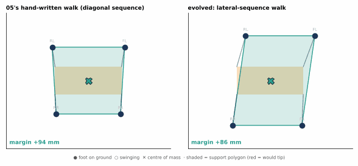
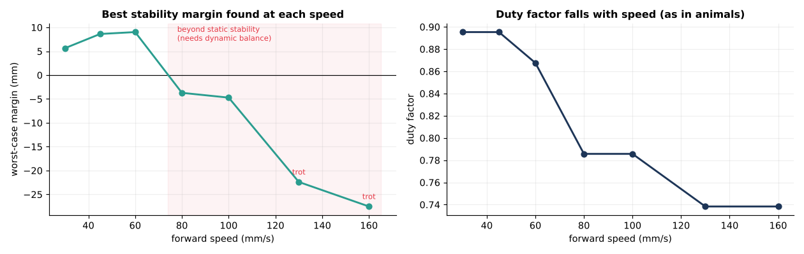
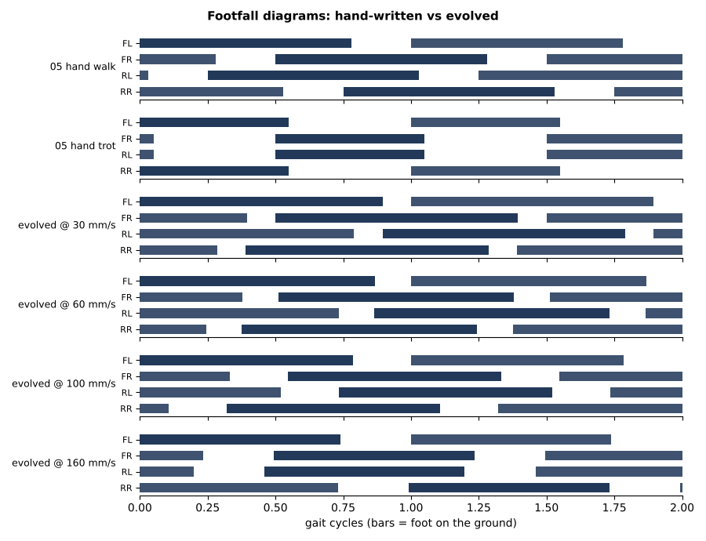
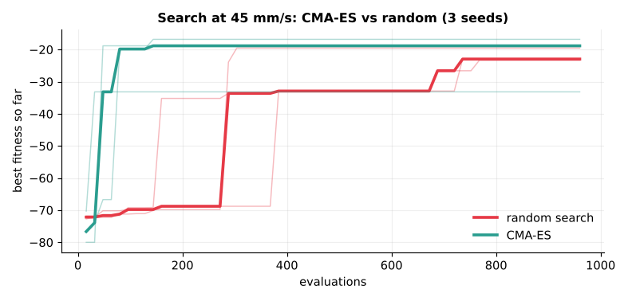

# 13 · Gait evolution for a 12-servo robot dog

Instead of hand-writing gaits, **evolve** them. Search over leg timing, stance and body sway for gaits that never tip over (quasi-statically) and work the servos as little as possible, on the exact leg geometry of [05-quadruped](https://github.com/PRIBINKBENNY/05-quadruped).



*Left: 05's hand-written walk lets the centre of mass (✕) slip outside the support polygon (red). Right: the evolved lateral-sequence walk keeps it inside (green) all cycle.*

## Iterations

| version | what changed | headline result |
|---|---|---|
| [v0.1](../../tree/v0.1) | quasi-static stability simulator on 05's leg IK, hand-written baselines, random search | every hand-written gait **would tip** |
| [v0.2](../../tree/v0.2) | from-scratch CMA-ES with wrapped phase genes | rediscovered the **lateral-sequence walk** animals use |
| [v0.3](../../tree/v0.3) | closed 3 optimizer loopholes (servo speed, foot lift, time aliasing), feasibility-first penalty, speed sweep + Pareto | max statically stable speed **≈ 74 mm/s**; 05's walk needs **2× the servo speed** an MG996R has |
| **v0.4** | figures, GIF, footfall diagrams, corrected footfall labels, export regenerated from the honest study | ready-to-use gait for 05 at 60 mm/s |

**Status: v0.4.**

## v0.1: a stability simulator and baselines

A gait is a **10-number genome**: phase offsets of three legs relative to front-left, duty factor, period, step height, stance width, body height, and **body sway** (amplitude and timing of shifting the body over the supporting legs).

Each genome is run through the real leg IK with joint limits, and scored on:
- **worst-case stability margin**: how far the centre of mass stays inside the polygon of feet on the ground, at the worst moment of the cycle (negative = it would tip if it froze)
- **servo effort**: summed joint speeds, a proxy for energy and wear
- **reachability**: any pose outside joint limits is heavily penalized

At 80 mm/s:

| gait | worst-case margin | effort (rad/s) | fitness |
|---|---|---|---|
| 05 walk (crawl), hand-written | −6.5 mm | 12.1 | −30.6 |
| 05 trot, hand-written | −6.0 mm | 11.3 | −28.6 |
| 05 walk + sway guess | −21.4 mm | 10.5 | −42.5 |
| random search, 640 evaluations (3 seeds) | −3.9 / +4.0 / −2.9 mm | 6.7–9.3 | −17.3 / −14.6 / −17.4 |

Two findings already: every hand-written gait **would tip** at some moment, and a guessed body sway made it **worse**, because the sway timing matters.

```bash
pip install -e ".[dev]" && pytest
```

## v0.2: CMA-ES rediscovers how animals walk

A from-scratch **CMA-ES** (covariance matrix adaptation evolution strategy, about 100 lines of NumPy). It adapts the shape of its search distribution, so it learns which genes move together. Phase genes wrap around (0 and 1 are the same moment) instead of being clipped.

Same budget, 640 evaluations, 5 seeds:

| | best fitness | worst-case margin | effort |
|---|---|---|---|
| random search | −14 to −20 | **tips on 4 of 5** (−3.9 to +4.0 mm) | 6.0–9.3 |
| **CMA-ES** | **−6.3 to +2.4** | **stable on 5 of 5** (+5.6 to +13 mm) | **5.1–6.3** |

**All five independent runs converged on the same footfall order: FL → RR → FR → RL** (each hind foot followed by the fore foot on the same side), the **lateral-sequence walk**. That's the pattern quadruped animals use for slow walking, and the one McGhee & Frank (1968) proved maximizes static stability. The hand-written gait in 05 uses the diagonal sequence (FL → RL → FR → RR), which is why it tips.

**What the optimizer exploited (not hidden):** it pushes duty to the maximum (0.95), the period to the slowest allowed (about 1.6 s), and **foot lift to 10 mm**, which would trip on a rug. Body sway goes unused because with 95% duty four feet are down most of the time. The model rewards exactly what it was told to, so v0.3 tightens the problem.

## v0.3: closing the loopholes the optimizer found

An optimizer optimizes **the simulator**, not the robot. This version found and closed three ways it was cheating:

| loophole | how it showed up | fix |
|---|---|---|
| 10 mm foot lift | best gaits shuffled their feet | ≥ 25 mm lift (rug clearance) |
| **no servo speed limit** | "stable" gaits with **20 ms swings**, needing 50+ rad/s | MG996R limit, 5.2 rad/s under load |
| **time-step aliasing** | gaits hid brief two-foot moments **between** the 64 samples per cycle; at 128 samples their margin collapsed to −129 mm | always evaluate at every lift-off and touch-down instant (results now identical at any resolution) |

Constraint handling is now **feasibility-first**: a single sample outside the servo or joint limits costs more than the whole range of the other fitness terms (a test proves this bound). Search uses 3 restarts per speed, a warm start from the neighbouring speed, and shares solutions across speeds.

### What the honest simulator says (best of 3+ CMA-ES runs per speed)

| speed (mm/s) | best gait found | worst-case margin | duty | period | peak joint speed |
|---|---|---|---|---|---|
| 30 | lateral-sequence walk | +5.7 mm | 0.90 | 1.60 s | 5.0 rad/s |
| 45 | lateral-sequence walk | +8.6 mm | 0.90 | 1.60 s | 5.2 rad/s |
| 60 | lateral-sequence walk | +9.0 mm | 0.87 | 1.57 s | 5.0 rad/s |
| 80 | lateral-sequence walk | -3.7 mm | 0.79 | 1.60 s | 3.8 rad/s |
| 100 | lateral-sequence walk | -4.7 mm | 0.79 | 1.60 s | 4.7 rad/s |
| 130 | trot | -22.4 mm | 0.74 | 1.60 s | 4.1 rad/s |
| 160 | trot | -27.5 mm | 0.74 | 1.60 s | 5.1 rad/s |

- **Maximum statically stable speed is about 74 mm/s** with MG996R servos (the margin crosses zero between 60 and 80 mm/s).
- **Duty factor falls as speed rises**, as in animals.
- **At 130 mm/s and above the optimizer switches to a trot by itself.** Trots balance dynamically, which a quasi-static model can only score as tipping. That's exactly where this model stops being the right tool.
- At 200 mm/s no gait in this family is both reachable and within servo speed.
- **Direct finding for 05-quadruped:** its shipped walk (0.5 s period, 35 mm lift) needs **11.3 rad/s** at the knee, about 2× what an MG996R can do. Use the exported gait instead (see v0.4), or slow 05's period to ≥ 1.5 s.

**Correction to v0.2:** its "stable on 5 of 5 seeds" result was measured before the servo limit and the aliasing fix, and doesn't survive them. The **lateral-sequence walk finding does survive**: every corrected run that walks stably uses it.

**Stability vs effort at 60 mm/s:** there's almost no trade-off. One gait is near-best at both until the effort weight reaches 16, and then it saves 5% effort for 2.6 mm less margin.

## v0.4: pictures, and a gait you can drop into 05





Footfall diagrams read left to right: each bar is a foot on the ground. The evolved gaits keep long, overlapping stance bars at low speed; by 160 mm/s the diagonal pairs line up into a trot.



At 45 mm/s CMA-ES finds its best region within about 150 evaluations; random search is still climbing after 960.

**Fixed in this version:** v0.2–v0.3 labelled footfall order by sorting phase offsets, but a *larger* offset means an *earlier* touchdown, so the printed arrows were reversed. The conclusion (evolved = lateral sequence, 05 = diagonal) was right; the arrow strings now match the standard Hildebrand definition, and a test pins it.

### Drop-in gait for 05-quadruped

[`docs/evolved_gait_60mms.yaml`](docs/evolved_gait_60mms.yaml), best stable gait from the corrected study:

| | value |
|---|---|
| speed | 60 mm/s |
| worst-case margin | **+9.0 mm** (never tips, checked at every lift-off/touch-down) |
| peak joint speed | 5.0 rad/s (within MG996R's 5.2) |
| offsets FR / RL / RR | 0.489 / 0.135 / 0.623, duty 0.87 |
| period, lift, height | 1.57 s, 25 mm, 149 mm |

It's a simulation result: try it on the real robot slowly, on a soft surface first.

```bash
python -m evolve.study   # rerun the speed sweep + Pareto (~10 min)
python -m evolve.viz     # regenerate everything in docs/
```

## Limits

Quasi-static only: no inertia, no foot slip, rigid body, flat ground. That's right for slow walks and exactly wrong for trots, which the README says where it matters.
